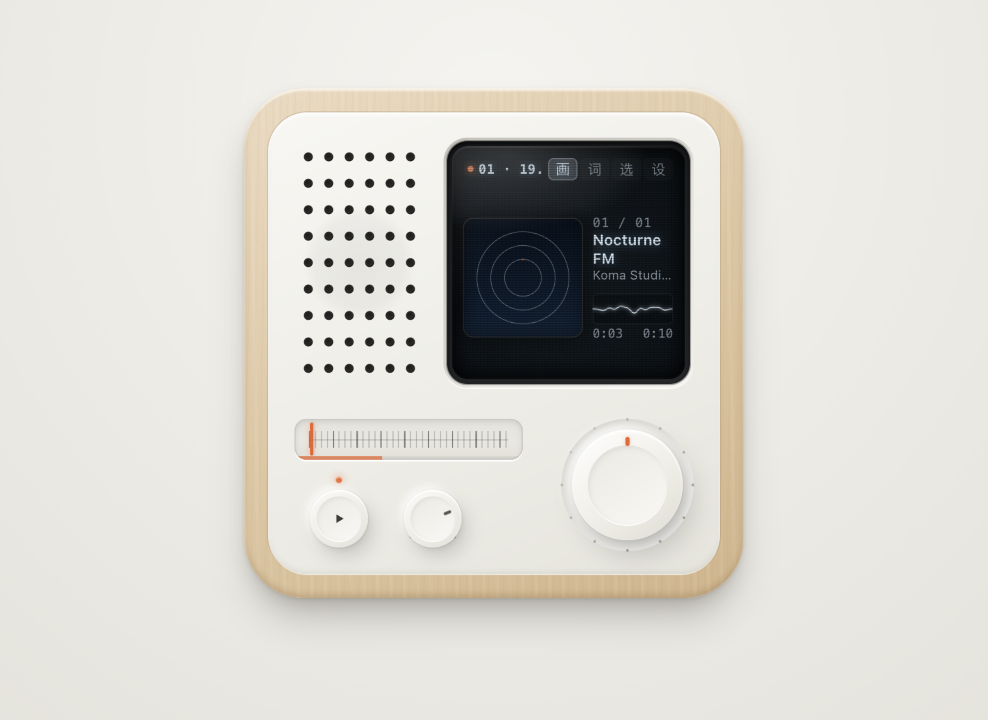

<p align="center">
  
</p>

<h1 align="center">Koma</h1>

<p align="center">
  基于 <strong>Tauri v2 + TypeScript</strong> 构建的跨平台（Windows / macOS）无边框透明新拟物微显像管桌面音乐播放器。
</p>

<p align="center">
  
</p>

---

## 特性

- **物理拟物机身**：浅枫木边框 + 哑光面板 + 1:1 方形暗色 CRT 显像管与零空闲 CPU 示波器，搭配实录机械开关与旋钮拟音。
- **三种桌面摆放模式**（右键机身或系统托盘切换）：
  - **置顶把玩**：悬浮于普通窗口上方
  - **桌面摆件**：钉在桌面图标层之上、普通应用窗口之下
  - **标准窗口**：参与系统常规窗口切换
- **零拷贝曲库**：不内置音频资源，支持直接拖入本地音频、文件夹或标准 `.zip` 压缩包（原位流式直读、不解压双份占盘，兼容 UTF-8 / GBK / Shift-JIS；原包移动后支持一键重新定位或移除），支持双语 `.lrc` 歌词与单曲/专辑双级封面。
- **系统媒体集成**：接入 Windows SMTC 与 macOS 控制中心。

## 音乐导入结构

直接将音频、文件夹或 `.zip` 拖入机身（或使用 `Ctrl/Cmd + O`）：

```text
music.zip（或任意本地文件夹）
└── 专辑目录/
    ├── cover.jpg          # 可选，专辑封面（缺省自动读取内嵌封面）
    ├── 01. 曲目.m4a       # 支持 flac / mp3 / m4a / wav / ogg / opus / aac / webm
    ├── 01. 曲目.lrc       # 可选，同名歌词（支持同时间戳双语）
    └── 01. 曲目.jpg       # 可选，单曲封面
```

## 开发与构建

环境依赖：[Bun](https://bun.sh/) >= 1.1、[Rust](https://rustup.rs/)、WebView2 Runtime（Windows 10/11 自带）/ WebKit（macOS 自带）。

```bash
bun install          # 安装前端依赖
bun run dev          # 浏览器预览前端
bun run tauri:dev    # 启动桌面应用开发模式
bun run tauri:build  # 构建安装包（Windows .msi/.exe；macOS .app/.dmg）
```
